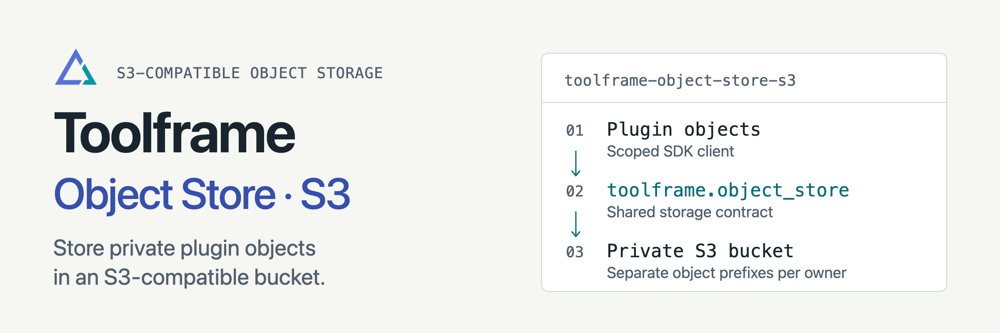

<p align="center">
<picture>
  <source media="(prefers-color-scheme: dark)" srcset="docs/assets/readme-banner-dark.png">
  <source media="(prefers-color-scheme: light)" srcset="docs/assets/readme-banner-light.png">
  
</picture>
</p>

# Toolframe S3 Object Storage

[](https://github.com/toolframe/toolframe-object-store-s3/actions/workflows/ci.yml?query=branch%3Amain)

Keep private Toolframe files in an existing S3-compatible bucket.
Business plugins use the same scoped object client as the local storage provider.

## Quick start

Use Python 3.14+, Core 0.7+ and SDK 0.4+. Create a private bucket and supply
application-scoped credentials through the standard AWS environment/profile chain.
Follow [bucket setup](docs/setup.md) to declare the package, bucket, endpoint and
prefix in `APP/toolframe.toml`, initially disabled. Apply the configuration:

```sh
toolframe --home APP apply
```

Disable any other object-store provider, then enable S3:

```sh
toolframe --home APP plugin enable object-store-s3
```

**Storage:** at most 64 MiB per object. The provider never creates buckets or
public URLs. Switching providers does not copy existing files; completed data
survives plugin removal. RustFS is the integration target; AWS S3 and other
services require their own acceptance run.

## Guides

| I want to… | Start here |
| --- | --- |
| Configure credentials and permissions | [Bucket setup](docs/setup.md) |
| Use the shared client | [SDK object storage](https://github.com/toolframe/toolframe-sdk/blob/main/docs/object-storage.md) |
| Run a local S3 integration | [RustFS checks](docs/development.md) |
| Contribute or run checks | [Contributing](CONTRIBUTING.md) |
| Publish a package | [Releasing](docs/releasing.md) |

[Releases](https://github.com/toolframe/toolframe-object-store-s3/releases)

## License

[Apache 2.0](LICENSE), with [NOTICE](NOTICE).
